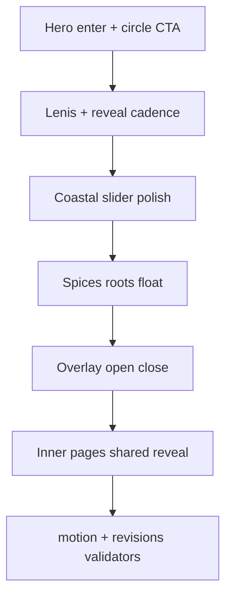

# JF Motion Feel Pass — Claude / Codex Plan

> **For agentic workers:** REQUIRED SUB-SKILL: Use `superpowers:executing-plans` or `superpowers:subagent-driven-development` task-by-task. Steps use checkbox syntax for tracking. Ponytail **full**: shortest working diff; no new animation libraries.

**Goal:** Make the Zingiber site feel premium on land — scroll cadence, reveals, hero/coast/experience motion inspired by JF — without changing brand theme or reworking the Menu page.

**Architecture:** Deepen the existing motion stack already in [`assets/js/zingiber.js`](assets/js/zingiber.js) + [`assets/css/zingiber.css`](assets/css/zingiber.css): Lenis smooth scroll, `data-zingiber-reveal` / `.zingiber-enhanced-motion`, CSS keyframes. No GSAP, anime.js, or new npm deps. Structure from [Design Direction 22 Oct](Design Direction for Zingiber 22 Oct 2026.pdf) and [Oct 30 Revisions](Zingiber Website Revisions 30 oct 2026.pdf) stays; this plan is a **feel pass**, not a layout rebuild.

**Tech stack:** WordPress custom theme (Vonaco base), PHP templates, CSS custom properties, vanilla JS, Lenis (already vendored), ego-browser / PHP validators under `tests/`.

## Reference websites (required)

Agents must open and use these live sites as the visual/motion reference. Copy structure and interaction feel only — **do not clone their brand colors, type, or copy.** Keep Zingiber tokens.

| Site | URL | Use for |
|------|-----|---------|
| Just Falafel / JF Vegan Cafe | https://jfvegancafe.com/ | Primary motion and feel: hero video/poster drama, circular SEE MENU CTA, scroll cadence, whitespace between sections, coastal slider cues, spices/floating decor, refined subtle animation throughout Home + shared chrome |
| Ballena Cabo | https://ballenacabo.com/ | Already-patterned Menu and chrome: Book Now + logo + hamburger overlay, story/principles rhythm, footer scale. **Menu page stays Ballena — do not redesign it in this pass** |

PDF callouts map the same split: JF for hero/coast/experience motion; Ballena for header/overlay/story/principles/footer structure already in theme.

## Global constraints

- Reference both https://jfvegancafe.com/ and https://ballenacabo.com/ before editing motion; match feel, not foreign brand surfaces.
- Palette/type frozen: `--zingiber-*` in [`assets/css/zingiber.css`](assets/css/zingiber.css) (`#0F0F0F` `#701616` `#9C4722` `#B87333` `#EDE7E1`; Estratto→Cormorant, Luxora→Manrope).
- **Do not modify Menu plate layout or `zingiber-menu-*` keyframes** except if a shared reveal change breaks Menu — then restore Menu behavior, do not redesign. Menu remains Ballena-patterned (https://ballenacabo.com/).
- No GSAP / anime / Swiper / new vendor scripts. Lenis + CSS + existing `zingiber.js` only.
- Hero video: poster-first; only play when `home.hero.video` / `<source src>` is non-empty ([`inc/zingiber/content.php`](inc/zingiber/content.php)).
- Animations: simple, subtle, refined; `prefers-reduced-motion: reduce` disables decorative motion and shows content at full opacity.
- Arabic `?lang=ar` must keep working; do not invent booking URL or real phone.
- Acceptance: `php tests/validate-zingiber-theme.php`, `php tests/check-zingiber-language.php`, with WP at `http://127.0.0.1:8080/`: `ego-browser nodejs < tests/check-zingiber-motion.mjs` and `ego-browser nodejs < tests/check-zingiber-revisions.mjs`.
- Do not commit/push/deploy unless the operator asks.

## File ownership

| File | Role |
|------|------|
| [`assets/css/zingiber.css`](assets/css/zingiber.css) | Tokens (duration/ease/section-space), reveal transitions, hero/coast/spice/root/overlay keyframes |
| [`assets/js/zingiber.js`](assets/js/zingiber.js) | Lenis lerp, reveal observer, coast controls, nav dialog Lenis stop/start |
| [`template-zingiber-home.php`](template-zingiber-home.php) | Reveal attributes / spice-root hooks only if missing — no section restructure |
| [`header-zingiber.php`](header-zingiber.php) | Overlay dialog classes for enter/exit only if CSS needs hooks |
| [`footer-zingiber.php`](footer-zingiber.php) / enquiry partial | Reveal hooks only |
| [`tests/check-zingiber-motion.mjs`](tests/check-zingiber-motion.mjs) | Assert new feel contracts without requiring Menu redesign |
| Skip: Menu-only CSS/JS paths, `content.php` copy (unless a CTA label key already exists) |

## Out of scope

- Menu page redesign or Ballena re-port
- GSAP / new frameworks
- Final hero MP4 ingest
- Structure rebuild from Design Direction if already shipped in Oct 30 WIP
- Cloning JF marble/green or Ballena beige surfaces

---

### Task 1: Motion tokens + Lenis cadence

**Files:** Modify [`assets/css/zingiber.css`](assets/css/zingiber.css) `:root`; Modify [`assets/js/zingiber.js`](assets/js/zingiber.js) Lenis init (~L10–18)

**Interfaces:**
- Consumes: existing `--zingiber-ease`, `--zingiber-duration`, `--zingiber-section-space`
- Produces: slightly longer reveal duration (~680–900ms), softer ease, modest section-space bump; Lenis `lerp` in ~0.07–0.1 range (tune toward JF smoothness without feeling sluggish)

- [ ] **Step 1:** Note current token values and Lenis `lerp: 0.09` before editing.
- [ ] **Step 2:** Adjust `:root` motion tokens only (duration, ease, section-space). Do not touch color/font tokens.
- [ ] **Step 3:** If scroll still feels snappy vs JF, nudge Lenis `lerp` by ≤0.02; leave other Lenis options alone.
- [ ] **Step 4:** Spot-check Home at 1440 with reduced-motion stills unchanged.
- [ ] **Step 5:** Commit only if operator asked: `chore(motion): tune Lenis and reveal tokens toward JF cadence`

### Task 2: Hero enter + circle SEE MENU feel

**Files:** Modify [`assets/css/zingiber.css`](assets/css/zingiber.css) `.zingiber-hero*` / `.zingiber-circle-link*`; touch [`template-zingiber-home.php`](template-zingiber-home.php) only if a reveal attr is missing

**Interfaces:**
- Consumes: three sketch rings + centered See Menu label (already asserted in motion test)
- Produces: JF-like hero land — soft media drift/fade, CTA ring hover scale/opacity ≤ subtle; CTA ≤ 110px width

- [ ] **Step 1:** Confirm hero CTA still has 3 ring paths and no orbit `textPath` (do not regress Oct 30 sketch CTA).
- [ ] **Step 2:** Refine hero media enter (existing `zingiber-hero-drift` or reveal) — longer, softer; no layout change.
- [ ] **Step 3:** Add/adjust circle-link hover/focus transitions (opacity/scale of rings or label); keep focus-visible.
- [ ] **Step 4:** Ensure empty video source still shows poster; no network request for empty `src`.
- [ ] **Step 5:** Run motion test Home assertions for CTA rings/size when WP is up.

### Task 3: Home section reveals + coastal polish

**Files:** [`assets/css/zingiber.css`](assets/css/zingiber.css) coastal + reveal stagger; [`assets/js/zingiber.js`](assets/js/zingiber.js) coast block (~L270+) only if needed

**Interfaces:**
- Consumes: `[data-zingiber-coast]`, index/progress/chevrons, `#coast-title`
- Produces: staggered Home reveals; coastal title rise; chevron/progress micro-motion; no new carousel lib; reduced-motion: no autoplay / no decorative anim

- [ ] **Step 1:** Ensure Home story/coast/principles/gallery-teaser children use `data-zingiber-reveal` where missing (minimal markup).
- [ ] **Step 2:** Tune stagger delays for Home section groups (not Menu plates).
- [ ] **Step 3:** Polish coastal index line + chevron feedback; keep native scroll-snap.
- [ ] **Step 4:** Keep `#coast-title` ≤ ~2 lines (`text-wrap: balance` / max-width) with rise on reveal.
- [ ] **Step 5:** Visual check 375 and 1440 — no horizontal overflow.

### Task 4: Experience spices + footer roots motion

**Files:** [`assets/css/zingiber.css`](assets/css/zingiber.css) `.zingiber-spice`, `.zingiber-root-motion`; Home gallery teaser / footer markup only if hooks missing

**Interfaces:**
- Consumes: existing `spices.svg` / `roots.svg` nodes
- Produces: idle float + reveal; zero `ginger-cluster` references; reduced-motion `animation: none`

- [ ] **Step 1:** Grep `ginger-cluster` — must stay zero hits.
- [ ] **Step 2:** Soften spice/root keyframes toward JF floating decor (slower, lower amplitude).
- [ ] **Step 3:** Confirm `@media (prefers-reduced-motion: reduce)` kills spice/root animations (motion test already asserts this).
- [ ] **Step 4:** Screenshot Experience + footer at 1440 for operator review if WP available.

### Task 5: Overlay chrome open/close polish

**Files:** [`assets/css/zingiber.css`](assets/css/zingiber.css) `zingiber-nav-*`; [`header-zingiber.php`](header-zingiber.php) / [`assets/js/zingiber.js`](assets/js/zingiber.js) dialog open/close only if class hooks needed

**Interfaces:**
- Consumes: Ballena-style full-screen `<dialog>` nav; existing Lenis stop/start on open/close
- Produces: smoother enter/exit (opacity/transform); Escape + focus trap unchanged; EN/AR still right of hamburger

- [ ] **Step 1:** Do not change header DOM order (Book Now | logo | hamburger | lang).
- [ ] **Step 2:** Soften overlay enter/exit keyframes/transitions; keep reduced-motion instant.
- [ ] **Step 3:** Verify Lenis still stops while dialog open and restarts on close.
- [ ] **Step 4:** Touch-check focus return to menu button.

### Task 6: Shared inner-page reveals (exclude Menu redesign)

**Files:** [`template-zingiber-page.php`](template-zingiber-page.php) / CSS shared reveals; **do not edit Menu plate keyframes**

**Interfaces:**
- Consumes: existing auto-tagging of images/fields in `zingiber.js` (~L322+)
- Produces: About/Gallery/Careers/Contact/enquiry share same reveal cadence as Home; Menu keeps current plate motion

- [ ] **Step 1:** Confirm Menu plate CSS paths are untouched in the diff.
- [ ] **Step 2:** Apply only shared `[data-zingiber-reveal]` timing changes that Menu can inherit safely.
- [ ] **Step 3:** If a shared change breaks Menu float/reveal, isolate Menu under a more specific selector and restore prior Menu timing.

### Task 7: Validators + visual gate

**Files:** Possibly extend [`tests/check-zingiber-motion.mjs`](tests/check-zingiber-motion.mjs); run existing harnesses

- [ ] **Step 1:** `php tests/validate-zingiber-theme.php`
- [ ] **Step 2:** `php tests/check-zingiber-language.php`
- [ ] **Step 3:** With local WP: `ego-browser nodejs < tests/check-zingiber-motion.mjs`
- [ ] **Step 4:** `ego-browser nodejs < tests/check-zingiber-revisions.mjs`
- [ ] **Step 5:** If feel contracts need locking (e.g. reveal duration floor, Lenis class present), add **one** small assert to motion test — no new test framework.
- [ ] **Step 6:** Stop. Report remaining visual gaps vs https://jfvegancafe.com/ (motion) and confirm Menu still matches Ballena intent at https://ballenacabo.com/; do not expand scope into Menu or GSAP.

## Agent split (Claude vs Codex)

| Agent | Prefer |
|-------|--------|
| **Codex** | Tasks 1–4 mechanical CSS/JS token + keyframe edits; run PHP validators |
| **Claude** | Tasks 5–7 overlay a11y, Menu isolation judgment, browser visual QA vs https://jfvegancafe.com/ + https://ballenacabo.com/ + PDFs |

Either agent may run the full plan solo via executing-plans; do not parallel-edit the same CSS regions.

## Success criteria

- Home feels smoother/more premium on first paint and scroll — cadence closer to https://jfvegancafe.com/ without JF colors.
- Menu page visually/behaviorally unchanged from pre-pass Ballena pattern (https://ballenacabo.com/).
- Brand tokens and Oct 30 structural PDF items still pass revisions harness.
- Reduced-motion path still shows all content and kills decorative animation.
- No new dependencies.