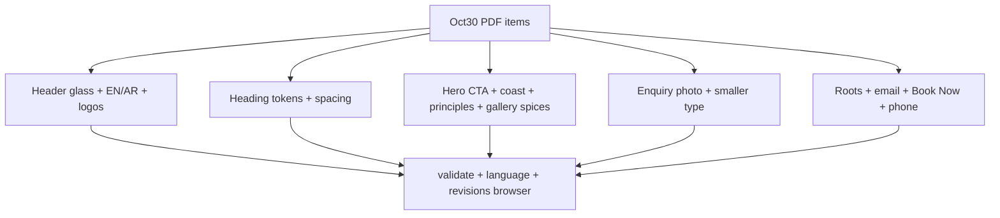

# Oct 30 Zingiber PDF Revisions — Codex Plan

> **For agentic workers:** REQUIRED SUB-SKILL: Use superpowers:executing-plans (or subagent-driven-development) task-by-task. Steps use checkbox syntax for tracking.

**Goal:** Close the Oct 30 client PDF against the live Zingiber theme so heading scale, glass chrome, EN/AR switch, roots/spices motion, principles visibility, enquiry/footer CTAs, and validators all match the brief.

**Architecture:** Keep the existing custom layer (`template-zingiber-*.php`, `header-zingiber.php`, `footer-zingiber.php`, `inc/zingiber/*`, `assets/css/zingiber.css`, `assets/js/zingiber.js`). No new dependencies. Prefer CSS tokens + native reveal/Lenis motion already in tree. Arabic stays query-param (`?lang=ar`) with draft copy in `content-ar.php` / `ui-ar.php`.

**Tech stack:** WordPress PHP templates, CSS custom properties, vanilla JS + Lenis, PHP/Node validators under `tests/`.

**Branch / baseline:** Work on current branch `codex/pdf-revisions-oct30`. Large WIP already exists (lang switch, Book Now button, roots SVG, spices, enquiry interior photo, phone placeholder, revision harness). This plan finishes and hardens that WIP — do not restart from `main`.

## Global constraints

- Palette and type families unchanged (`--zingiber-*` in [`assets/css/zingiber.css`](assets/css/zingiber.css)).
- Animations: simple, subtle, reduced-motion safe (`prefers-reduced-motion: reduce` kills decorative motion).
- No invented booking provider; phone stays non-dialable placeholder until confirmed (`phone` empty, `phone_label` = `+971 50 123 4567`).
- Hero video: keep poster path; only request media when `home.hero.video` is non-empty ([`inc/zingiber/content.php`](inc/zingiber/content.php) currently `video => ''`).
- Acceptance source of truth: [`tests/check-zingiber-revisions.mjs`](tests/check-zingiber-revisions.mjs) + `php tests/validate-zingiber-theme.php` + `php tests/check-zingiber-language.php`.
- Do not commit/push/deploy unless the operator asks.

## PDF → code map (locked decisions)

| PDF # | Decision | Primary files |
|---|---|---|
| 1 | Shrink **all** display sizes via tokens; remove oversized hero override `clamp(2.5rem…5.25rem)` so hero uses `--zingiber-type-hero` | `zingiber.css` `:root` + hero block ~2900 |
| 2 | Keep JF-style menu plate reveal/float on Menu page | `template-zingiber-page.php`, menu-plate CSS/keyframes |
| 3 | EN / العربية **after** hamburger (PDF red box is right of menu) | [`header-zingiber.php`](header-zingiber.php) `.zingiber-header__end` order |
| 4/7 | Poster-first; wire MP4 later via content key only | `template-zingiber-home.php`, `zingiber.js` hero video init, `content.php` |
| 5 | Use Dropbox English logo already converted to SVG | `assets/svg/zingiber/english-logo*.svg`, header/footer/preloader refs |
| 6 | Glass masthead (`backdrop-filter` + translucent sand/charcoal); not a solid dark bar | `.zingiber-header` / sticky rules |
| 8 | Circle CTA ≤ 110px (target ~6–6.25rem) | `.zingiber-hero__cta` |
| 9 | Larger `--zingiber-section-space`; keep Lenis + `data-zingiber-reveal` | CSS tokens + existing JS |
| 10 | Coastal H2 ≤ ~2 lines (`max-width` + `text-wrap: balance`) + rise animation | `#coast-title`, `.zingiber-coastal h2` |
| 11 | Desktop: **all four** principles visible; ≤1100px: 2×2; smaller heading | `.zingiber-principle-cards` grid (not horizontal peek strip) |
| 12 | Floating spice SVGs + root drift on Gallery teaser (“The Zingiber Experience”) | `template-zingiber-home.php` `#gallery`, `spices.svg`, CSS keyframes |
| 13–14 | Smaller enquiry H2; restaurant interior photo in enquiry art | [`template-parts/zingiber-enquiry.php`](template-parts/zingiber-enquiry.php) |
| 15 | Delete ginger-cluster usage; animated `roots.svg` only | footer/home/enquiry templates; ensure `ginger-cluster` gone |
| 16 | Smaller footer email | `.zingiber-footer__email` |
| 17 | Phone placeholder text | `content.php` `phone_label` |
| 18 | Ballena-style footer rhythm (columns + oversized wordmark) — already structure; polish spacing only | `footer-zingiber.php`, footer CSS |
| 19 | “Book Now” solid/outlined button, not underlined text | `.zingiber-footer__book`, header `.zingiber-book-link` |

## File ownership

- Create/keep: `assets/svg/zingiber/{english-logo,english-logo-light,english-wordmark,roots,spices}.svg`, `inc/zingiber/{language,content-ar,ui-ar}.php`, `tests/check-zingiber-{language,revisions}.*`
- Modify: `assets/css/zingiber.css`, `assets/js/zingiber.js`, `header-zingiber.php`, `footer-zingiber.php`, `template-zingiber-home.php`, `template-zingiber-page.php`, `template-parts/zingiber-enquiry.php`, `inc/zingiber/{content,setup,enquiry}.php`, existing validators/README if needed
- Delete: any remaining `ginger-cluster` references (PNG already deleted in WIP)

---

### Task 1: Language chrome matches PDF red box

**Files:** `header-zingiber.php`, language CSS in `zingiber.css`, `tests/check-zingiber-revisions.mjs`

**Interfaces:** Produces `.zingiber-header__end` with order: menu toggle, then `.zingiber-language` (EN then العربية). Consumes `zingiber_page_url` / `zingiber_is_arabic`.

- [x] Swap DOM order so language sits **right of** the hamburger (PDF markup).
- [x] Keep 44px hit targets, sticky contrast, `prefers-reduced-transparency` solid fallback.
- [x] Confirm revisions harness `langNearMenu` still passes with the new side.

### Task 2: Global type scale + section air

**Files:** `assets/css/zingiber.css`

- [x] Lower `:root` `--zingiber-type-hero` / `--zingiber-type-section` (~10–15% from current token caps).
- [x] Remove/override the late hero rule that sets `font-size: clamp(2.5rem, 5.3vw, 5.25rem)` so it cannot defeat the tokens.
- [x] Shrink enquiry H2 and principles section H2 in the same pass.
- [x] Bump `--zingiber-section-space` slightly for PDF item 9.

### Task 3: Hero glass, circle, logo, video contract

**Files:** `header-zingiber.php`, `template-zingiber-home.php`, `zingiber.css`, `zingiber.js`, `content.php`

- [x] Confirm SVG logos wire through header, nav dialog, preloader mask, footer wordmark.
- [x] Soften masthead/veil toward translucent glass (already partially done — verify sticky returns to sand per revisions test).
- [x] Cap `.zingiber-hero__cta` ≤ 110px; keep Latin orbit textPath.
- [x] Leave `hero.video` empty; JS must not request empty `<source>`; poster remains until asset arrives.

### Task 4: Coastal heading + principles first glance

**Files:** `template-zingiber-home.php`, `zingiber.css`

- [x] Force `#coast-title` (“A Contemporary Take on Coastal India”) to ≤2 lines via `max-width` / balance; keep `zingiber-coast-rise` on reveal.
- [x] Principles: desktop `repeat(4, 1fr)`, tablet `repeat(2, 1fr)`; no peek-only horizontal strip on desktop.
- [x] Reduce principles heading size with shared section token.

### Task 5: Experience spices + roots (kill ginger art)

**Files:** `template-zingiber-home.php`, `footer-zingiber.php`, `template-parts/zingiber-enquiry.php`, `assets/svg/zingiber/{roots,spices}.svg`, CSS keyframes

- [x] Gallery teaser keeps four `.zingiber-spice` nodes + root decoration with idle float; honor reduced motion.
- [x] Grep repo for `ginger-cluster` / photoreal ginger — zero hits.
- [x] Enquiry art uses interior restaurant image (already `interior-dining-room.jpg`) + roots.

### Task 6: Footer / Book Now / contact copy

**Files:** `footer-zingiber.php`, `content.php`, footer CSS

- [x] Email size already reduced in WIP — verify visually against PDF item 16.
- [x] Phone placeholder `+971 50 123 4567` with `dir="ltr"`.
- [x] `.zingiber-footer__book` is bordered button labeled **Book Now** (not underline).
- [x] Header CTA already Book Now — leave consistent.

### Task 7: Menu page JF motion (item 2)

**Files:** `template-zingiber-page.php` menu plates, `zingiber.css` menu-plate animations

- [x] Keep staggered plate reveal + gentle float; no new libraries.
- [x] Spot-check Menu page at 1440/375 for overflow and reduced-motion stills.

### Task 8: Validate and screenshot

**Files:** tests only (no product change unless RED)

- [x] `php tests/validate-zingiber-theme.php`
- [x] `php tests/check-zingiber-language.php`
- [x] With WP at `http://127.0.0.1:8080/`: `ego-browser nodejs < tests/check-zingiber-revisions.mjs`
- [x] Also run browser/footer checks if enquiry or footer markup changed: `tests/check-zingiber-browser.mjs`, `tests/check-zingiber-footer.mjs`
- [x] Inspect `/tmp/zingiber-revisions/*` against PDF pages 1–6 (lang right of menu, smaller type, four pillars, roots not ginger, Book Now button).

## Out of scope (say so, do not build)

- Final hero MP4 ingest (client asset missing).
- Real phone / booking integration.
- Arabic copy linguistic QA (draft only; editor sign-off later).
- New animation frameworks or redesign outside the PDF list.

## Completed follow-up: supplied sketch circle and Lofty Lab motion

The later client reference supersedes the Latin orbit text requirement: use three thin sketch rings and a centered, translated See Menu label. Shared entrances now include lift/scale, image tilt, staggered headings/forms and scroll-linked image drift. Native reduced-motion stills and existing Lenis/dialog behavior remain covered. `tests/check-zingiber-motion.mjs`, existing revisions/browser/footer validators and PHP checks pass.
