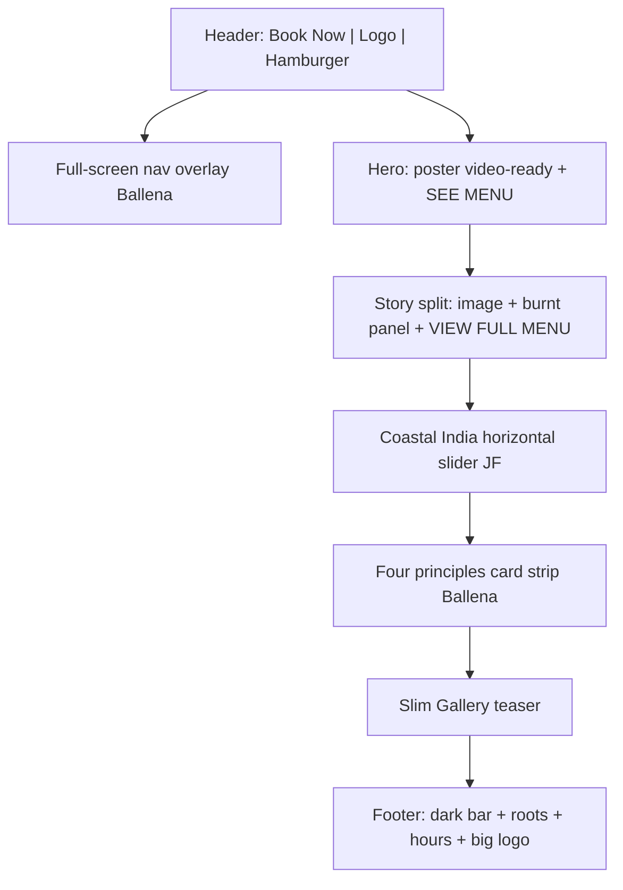

# PDF Design Direction — Structure Plan

## Decisions locked

| Decision | Choice |
|----------|--------|
| Hero media | **Poster first** — keep current interior still; add `<video>` markup + poster attrs ready for a later file |
| Orphan Home sections | **Absorb** — Experience + Reservations fold into footer/contact; **slim Gallery teaser** only on Home |
| Brand | Keep Zingiber palette, fonts, approved copy — do **not** clone Ballena/JF colors or copy |
| Desktop freeze | **Lifted** — PDF is a structural redesign for all viewports |

Reference PDF: attached `Design_Direction_for_Zingiber.pdf` (7 pages). Live refs: [ballenacabo.com](https://ballenacabo.com), [jfvegancafe.com](https://jfvegancafe.com).

---

## Approaches (pick one)

**A — Pixel-faithful clone** of Ballena/JF chrome and motion  
Tradeoff: high effort, brand drift risk, hard to maintain in Vonaco theme.

**B — Pattern port (recommended)**  
Same **structure + interaction** as the PDF callouts; keep Zingiber tokens, type, imagery, and copy. CSS/JS only where needed; reuse existing content keys in [`inc/zingiber/content.php`](inc/zingiber/content.php).

**C — Light restyle** of current sections without overlay menu / sliders  
Tradeoff: fails PDF “structure same” requirement.

**Recommendation: B.** Ponytail: fewest new abstractions; caveman: match structure, not foreign brand.

---

## Target Home structure (after)



**Removed from Home markup:** `#experience`, `#reservations` (content reused in footer / Contact).  
**Kept as pages:** About, Menu, Gallery, Careers, Contact — inherit new header/footer.

---

## Section mapping (PDF page → build)

### 1. Header + overlay (PDF p2 → Ballena)

Rewrite [`header-zingiber.php`](header-zingiber.php):

- Layout: **Book Now** (left) → **logo center** → **hamburger** (right). Drop inline primary link row on desktop.
- Book Now → `/contact/` (no booking URL yet; phone still unset).
- Overlay: full-viewport panel, centered links (Home, About, Menu, Gallery, Careers, Contact + Instagram), optional bottom image teaser from existing food asset.
- Open/close: hamburger ↔ X; focus trap + Escape; `prefers-reduced-motion` short-circuits motion.
- Touch: [`assets/js/zingiber.js`](assets/js/zingiber.js) — extend existing menu toggle; do not add a framework.

### 2. Hero (PDF p2 → JF)

Rewrite hero in [`template-zingiber-home.php`](template-zingiber-home.php):

```html
<video playsinline muted loop poster="…interior-hero…" hidden or empty source>
  <!-- source added when client file lands -->
</video>

```

- Circular **SEE MENU** CTA (JF pattern) → `/menu/`.
- Keep eyebrow/lede only if they still fit the new composition; prefer PDF hero budget: brand + one line + one CTA.
- Autoplay only when a real `<source>` exists; until then poster shows.

### 3. Story split (PDF p3 → Ballena “Flavors…”)

Remap current `#chef` / chef_story:

- ~50/50: food/chef image | solid **burnt-red / terracotta** panel.
- Eyebrow MENU (or story eyebrow), large display headline from approved story heading, body from chef copy, **VIEW FULL MENU** circular-arrow link → `/menu/` (or About if “Discover Our Story” retained — default Menu to match PDF).

### 4. Coastal India slider (PDF p4 → JF)

Remap `#coastal-regions` from stacked regions to **horizontal slider**:

- Slides: Goa, Kerala, Mangalore, Tamil Nadu (existing region data).
- Controls: index `01 / 04`, thin progress line, open-circle chevrons (JF “small design elements”).
- Native scroll-snap + buttons; no new carousel library.
- Reduced motion: no auto-advance.

### 5. Four principles cards (PDF p5 → Ballena)

Remap `#principles` from 4-up grid to **horizontal card strip** (image card + label + short line + Explore):

- Map Authenticity / Innovation / Consistency / Storytelling onto 4 cards using existing principle copy + interior/food crops.
- Desktop: 3 visible + peek or snap; mobile: 1–1.2 cards.

### 6. Slim Gallery teaser

Replace 12-col mosaic with **3–4 tile strip** + “View Gallery” → `/gallery/`. Full mosaic stays on Gallery page.

### 7. Footer (PDF p6–7 → JF + Ballena)

Rewrite [`footer-zingiber.php`](footer-zingiber.php):

1. Dark textured bar: contact CTA + phone placeholder / email; **root motif** (not leaves) — new SVG from ginger/root contour in brand assets.
2. Sand band: address, hours, socials (absorb reservation details).
3. Oversized **ZINGIBER** wordmark / logo lockup (Ballena-scale).
4. Optional contact strip from PDF p7 only if Contact page remains thin — prefer **reuse Contact page form**, not duplicate a second form on every page (YAGNI).

---

## Brand / UX constraints (ui-ux-pro-max + existing)

- Palette stays: `#0F0F0F` `#701616` `#9C4722` `#B87333` `#EDE7E1`.
- Display/body: Estratto→Cormorant, Luxora→Manrope.
- No Ballena beige/black or JF marble as primary surfaces.
- Focus-visible, 44px targets, Escape closes overlay, `prefers-reduced-motion`.
- Test: 375 / 768 / 1024 / 1440 after structure lands (prior mobile-only CSS may need pruning where new structure supersedes it).

---

## File touch list (fewest)

| File | Change |
|------|--------|
| [`header-zingiber.php`](header-zingiber.php) | Ballena chrome + overlay markup |
| [`footer-zingiber.php`](footer-zingiber.php) | JF bar + roots + big logo; absorb visit/hours |
| [`template-zingiber-home.php`](template-zingiber-home.php) | New section order; drop experience/reservations; slim gallery |
| [`assets/css/zingiber.css`](assets/css/zingiber.css) | New layout/interaction styles; retire obsolete Home rules |
| [`assets/js/zingiber.js`](assets/js/zingiber.js) | Overlay, coast slider, optional principles snap |
| [`inc/zingiber/content.php`](inc/zingiber/content.php) | Only if new labels/CTA keys needed |
| New: `assets/svg/zingiber/roots.svg` (or similar) | Root decoration |
| [`tests/validate-zingiber-theme.php`](tests/validate-zingiber-theme.php) | Update structural assertions if they pin old Home blocks |

**Out of scope:** cloning third-party assets/copy; inventing booking URL/phone; WooCommerce; new npm deps.

---

## Implementation phases (for Codex / writing-plans later)

1. Spec doc → `docs/superpowers/specs/2026-10-22-zingiber-pdf-structure-design.md` (after you approve this plan).
2. Header + overlay (chrome first — every page benefits).
3. Hero poster + video-ready shell + SEE MENU.
4. Story split panel.
5. Coastal slider + principles cards.
6. Slim gallery + footer roots/logo; remove Home experience/reservations.
7. Validator + visual pass at 375/768/1024/1440 on local `http://127.0.0.1:8080/`.

---

## Success criteria

- Home section order matches PDF narrative (header → hero → story → coast slider → principles → gallery teaser → footer).
- Overlay menu behaves like Ballena (open/close animation, centered links).
- Hero shows poster today; drops in a file later without markup rewrite.
- No Experience/Reservations sections on Home; visit details live in footer/Contact.
- Brand tokens + approved copy preserved; `php tests/validate-zingiber-theme.php` passes.
